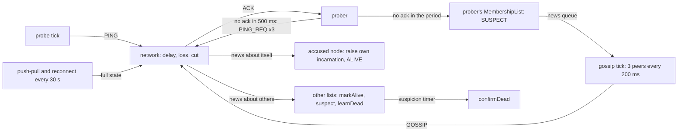

# Architecture of seatwave-membership

A deterministic simulator of failure detection and membership for SeatWave's nodes, on a virtual clock. It needs only the JDK; the libraries in the build are for the tests, the formatter and coverage.

## Packages

One package, `io.plainround.seatwave.membership`. Every type is package-private except the six `*Cli` programs, whose `main` methods are public.

| Type | Role |
|---|---|
| `NetworkConditions` | one-way delay as a three-band mixture (p99 200 ms on the on-sale network) and an independent loss per message |
| `PauseSchedule` | garbage-collection pauses, steady and busy; pauses never overlap |
| `FailureDetector` | sealed: arrivals in, a suspicion level, a threshold and the silence after which it suspects out |
| `FixedTimeoutDetector`, `PhiAccrualDetector` | the two detectors; phi in Pekko's form, with a window of intervals and an acceptable pause |
| `HeartbeatSimulation` | all-to-all heartbeats; counts false positives on a healthy run and detection times over crashes, the same arrivals for every detector |
| `MembershipList` | ALIVE, SUSPECT, DEAD with incarnations; the only way a member changes; outcomes `Applied` or `Refused` with a `Reason` |
| `GossipSimulation` | synchronous rounds of push or push-pull gossip with fan-out and loss |
| `MembershipCluster` | every node its own `MembershipList`; probes, acks, indirect probe requests, gossip, push-pull and reconnects as messages on the simulated network; crashes and partitions |
| `DetectorSweepCli`, `SuspicionTimelineCli`, `GossipCli`, `SwimProbeCli`, `PartitionCli`, `ClusterScaleCli` | the only code that prints |

Dependency rule: `*Cli` -> (`HeartbeatSimulation`, `GossipSimulation`, `MembershipCluster`, `MembershipList`) -> (`FailureDetector` and its two detectors, `NetworkConditions`, `PauseSchedule`). Nothing below a `*Cli` prints or exits.

## Data flow of the per-node simulation

## Walk-throughs

A crash: the crashed node answers nothing. Some node's probe gets no ack within 500 ms; it asks three members it holds ALIVE to probe; none answers within the period, so at its next probe tick it marks the node SUSPECT and queues the news. Gossip carries it, each item at most 4 x ceil(log10(N + 1)) times from each node; every list that applies it starts its own suspicion timer, 4 x max(1, log10 N) s. The first timer to fire confirms the death, and that list's DEAD news reaches the rest, usually before their own timers fire.

A partition: every message across the cut is dropped. Each side's probes of the other fail, helpers on the same side cannot reach across either, so each side suspects and removes every node of the other. After the heal neither side probes or gossips to members it holds DEAD (gossip to the dead stops 30 s after a death), so nothing changes until a node's reconnect tick exchanges full state with a member it holds DEAD. A node that finds itself DEAD (taken as SUSPECT) in the received state refutes with incarnation + 1, the refutations spread by gossip, and the lists agree again.

## Decisions and trade-offs

- A virtual clock, not threads: runs are repeatable byte for byte, which lets the module print real model numbers. The cost: no real contention and no real network; every delay is the model's assumption.
- The per-node simulation follows memberlist and Serf where they decide something (helpers only among ALIVE members, no gossip without news, gossip to the dead for 30 s, a DEAD entry in received state taken as a suspicion, reconnect every 30 s), so its failures are the protocol's, not the model's. Lifeguard, piggybacking, size limits and encryption are left out.
- `SwimProbeCli` keeps the seed's shared view, because later modules quote its numbers; `MembershipCluster` replays that view as `ViewModel.SHARED` so the two can be compared on the same cut.
- Every message draws both its delay and its loss, even one a cut drops, so a partition does not shift the random draws of the rest of a run.

## Invariants and where they are enforced

| Invariant | Enforced by | Tested by |
|---|---|---|
| A node is removed only after a crossed threshold and an unrefuted suspicion that stood for the timeout | `MembershipList.confirmDead`, `MembershipList.Suspicion` | `MembershipListTest` |
| A removed node comes back only with a higher incarnation; an older or equal ALIVE is refused in every state | `MembershipList.markAlive` | `MembershipListTest`, `MembershipClusterTest` |
| A repeated suspicion does not restart its timer | `MembershipList.suspect` | `MembershipListTest` |
| A death report older than a refutation is refused | `MembershipList.learnDead` | `MembershipListTest` |
| Only the accused node raises its own incarnation | `MembershipCluster.receive` (news about itself) and `refute` | `MembershipClusterTest` |
| A state exchange alone never removes a member | `MembershipCluster.receive` (DEAD in state taken as SUSPECT) | `MembershipClusterTest` |
| After a heal every list agrees within 35 s | reconnect ticks and refutation | `MembershipClusterTest` |
| The same seed gives the same run | two seeded sources, ties broken by scheduling order | `MembershipClusterTest`, `HeartbeatSimulationTest` |
| Phi's crossing point is where phi reaches the threshold; old intervals leave the window | `PhiAccrualDetector` | `PhiAccrualDetectorTest` |
| A gossip round never sends to self and never twice to one peer | `GossipSimulation.distinctPeers` | `GossipSimulationTest` |
| An invalid value cannot exist (shares above 1, negative incarnation, fan-out not below N, a partition that ends before it starts) | compact constructors | the test classes above |
